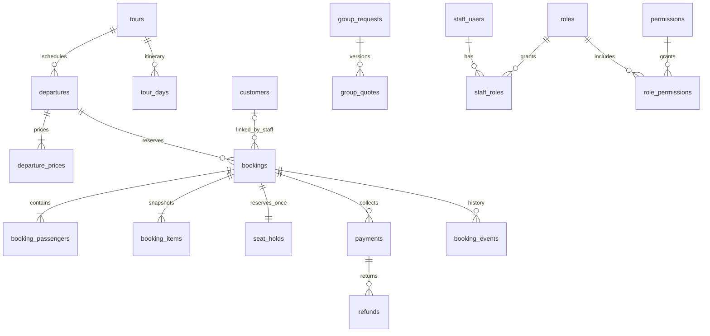

# Thiết kế cơ sở dữ liệu — Blue Sky Group

Phiên bản 0.1 · 22/11/2026 · Thiết kế đề xuất, chưa phải migration đã chạy. PostgreSQL 17 baseline. Phạm vi MVP theo [PLAN](../agent/PLAN.md); hợp đồng dữ liệu ra ngoài theo [API](api-spec.md). Các bảng ghi **sau MVP** không tạo trước khi triển khai tính năng đó.

## 1. Quy ước

- Tên `snake_case`; PK `id uuid` do ứng dụng sinh ngẫu nhiên (hoặc `gen_random_uuid()`), trừ bảng nối/composite key ghi riêng. UUID không thay thế kiểm tra quyền.
- Mọi bảng có `created_at timestamptz NOT NULL DEFAULT now()`; bảng mutable có thêm `updated_at timestamptz NOT NULL DEFAULT now()`, service cập nhật trên mọi mutation. Bảng event/audit/payment history không sửa nội dung quá khứ.
- Cột mặc định `NOT NULL`, ký hiệu `?` là nullable; `UQ` unique; `FK table` tham chiếu PK. Chuỗi trạng thái dùng `text CHECK (...)` để migration enum dễ kiểm soát. Chuỗi ngắn có giới hạn ở DB hoặc API như mô tả.
- Tiền `bigint CHECK(amount >= 0)`, đơn vị VND nguyên đồng, `currency char(3) DEFAULT 'VND' CHECK(currency='VND')`. API serialize tiền thành chuỗi thập phân. Phần trăm dùng basis points 0..10000. Không float cho tiền.
- UTC cho timestamp; lịch ngày dùng `date`; timezone hiển thị/báo cáo `Asia/Ho_Chi_Minh`. Thời gian hết hạn lấy từ DB, không từ browser.
- FK mặc định `ON DELETE RESTRICT`. Chỉ cascade bảng nối/chi tiết nội dung chưa có lịch sử giao dịch; không cascade booking/payment/audit. Archive tour, account, media thay xoá nếu đã sử dụng.
- JSONB chỉ dùng cho nội dung/snapshot/provider metadata không nhạy cảm; không cất quan hệ giao dịch hay counters trong JSON. Version schema snapshot bằng `schema_version`.
- Email chuẩn hoá lowercase/trim; số điện thoại E.164. Không đặt unique SĐT/email cho khách vì gia đình có thể dùng chung; không tự merge hồ sơ.
- Token chỉ lưu SHA-256 hash từ random secret ≥256 bit. Mật khẩu Argon2id hoặc bcrypt. Không lưu thẻ/CVV, access JWT hay refresh token dạng rõ trong DB/log.

## 2. Sơ đồ quan hệ cốt lõi

## 3. Identity, khách hàng, bảo mật

| Bảng | Cột đặc thù ngoài id/timestamps | Ràng buộc/index |
| --- | --- | --- |
| `staff_users` | `email varchar(254), password_hash text, full_name varchar(120), status text(active/disabled), last_login_at timestamptz?` | UQ lower(email); disable => revoke session; không xoá người đã tạo audit |
| `roles` | `code text, name text` | UQ code: `admin, product_manager, sales, accountant, executive` |
| `permissions` | `code text, description text` | UQ code; tên quyền theo api-spec |
| `staff_roles` | `staff_id FK staff_users, role_id FK roles` | PK(staff_id,role_id), không id/updated_at |
| `role_permissions` | `role_id FK roles, permission_id FK permissions` | PK(role_id,permission_id), không id/updated_at |
| `staff_sessions` | `staff_id FK, token_hash text, family_id uuid, expires_at timestamptz, revoked_at timestamptz?, replaced_by uuid? FK staff_sessions` | UQ token_hash; index(staff_id,expires_at); rotation mỗi refresh, reuse revoke family |
| `password_reset_tokens` | `staff_id FK, token_hash text, expires_at timestamptz, used_at timestamptz?` | UQ token_hash; một lần, MVP delivery mock chỉ admin được quyền đọc |
| `customers` | `full_name varchar(120), email varchar(254)?, phone varchar(20)?, company_name varchar(200)?, notes text?, archived_at timestamptz?` | CHECK email hoặc phone có giá trị; index email/phone không unique; CRM nhân viên, chưa có password |
| `guest_sessions` | `token_hash text, expires_at timestamptz, revoked_at timestamptz?` | UQ token_hash; creator session cho checkout, không tài khoản khách |
| `booking_lookup_tokens` | `booking_id FK bookings, token_hash text, expires_at timestamptz, revoked_at timestamptz?` | UQ token_hash; read-only summary, TTL 15 phút |
| `audit_logs` | `actor_staff_id FK?, action text, entity_type text, entity_id uuid?, request_id text, changed_fields jsonb, reason text?, ip_hash text?` | append-only; index(entity_type,entity_id,created_at), (actor_staff_id,created_at); không lưu token/PII raw trong before/after |

Rate limit MVP dùng process limiter + PostgreSQL counter cho login/lookup/form để không reset khi restart: `rate_limit_buckets(key_hash text PK, window_start timestamptz, count int CHECK(count>=0), expires_at timestamptz)`. Atomic upsert, index expires_at; key có scope và time window, không lưu PII rõ. Không cần id/created_at/updated_at ở bảng tạm này.

## 4. Catalog, giá và inventory

| Bảng | Cột | Ràng buộc/index |
| --- | --- | --- |
| `destinations` | `slug varchar(180), name varchar(160), description text, country_code char(2), latitude numeric(9,6)?, longitude numeric(9,6)?, cover_media_id FK media_assets?, seo_title varchar(160)?, seo_description varchar(320)?, published bool DEFAULT false` | UQ slug; lat -90..90, lng -180..180 |
| `tour_categories` | `slug varchar(180), name varchar(120), description text, sort_order int DEFAULT 0` | UQ slug |
| `tours` | `slug varchar(180), code varchar(32), title varchar(200), summary text, description text, region text(domestic/international), audience text(general/school/company), duration_days smallint, duration_nights smallint, origin_name text, transport text, difficulty text(easy/moderate/hard), hotel_summary text?, included text, excluded text, cancellation_policy text, preparation_guide text?, age_policy jsonb, status text(draft/published/archived), featured bool DEFAULT false, cover_media_id FK?, seo_title varchar(160)?, seo_description varchar(320)?, published_at timestamptz?` | UQ slug/code; days>0, nights>=0; index(status,region), (status,published_at); price/remaining lấy departure, không lưu giá từ thủ công |
| `tour_destinations` | `tour_id FK, destination_id FK, sort_order int` | PK(tour_id,destination_id), index(destination_id,tour_id) |
| `tour_category_links` | `tour_id FK, category_id FK` | PK(tour_id,category_id), index(category_id,tour_id) |
| `tour_days` | `tour_id FK, day_number smallint, title text, body text, meals text?, accommodation text?` | UQ(tour_id,day_number); day_number>0 |
| `tour_stops` | `tour_id FK, day_number smallint, sort_order int, name text, latitude numeric(9,6), longitude numeric(9,6), description text?` | UQ(tour_id,day_number,sort_order), lat/lng CHECK |
| `tour_media` | `tour_id FK, media_id FK, caption text?, sort_order int` | PK(tour_id,media_id) |
| `departures` | `tour_id FK, starts_at timestamptz, ends_at timestamptz, sales_close_at timestamptz, capacity int, held_seats int DEFAULT 0, confirmed_seats int DEFAULT 0, status text(draft/open/closed/cancelled/completed), price_version int DEFAULT 1, deposit_bps int DEFAULT 3000, balance_due_at timestamptz, currency char(3)` | capacity>0; counters>=0; held+confirmed<=capacity; starts<ends; sales_close<=starts; balance_due<starts; 0<deposit_bps<=10000; UQ(tour_id,starts_at); index(status,starts_at), (tour_id,starts_at) |
| `departure_prices` | `departure_id FK, passenger_type text(adult/child/infant), unit_price bigint, seats_per_person smallint, min_age int, max_age_exclusive int?` | PK(departure_id,passenger_type); price>=0, seats in(0,1), min_age>=0, max>min; service bảo đảm 3 loại không chồng tuổi, có adult |
| `departure_surcharges` | `departure_id FK, code varchar(40), label text, amount bigint, unit text(per_booking/per_person), required bool DEFAULT true` | UQ(departure_id,code); amount>=0; per_person áp dụng tất cả hành khách, nếu cần theo loại tạo rule rõ bằng migration |
| `pricing_quotes` | `departure_id FK, guest_session_id FK?, created_by_staff_id FK?, price_version int, counts jsonb, selected_surcharge_codes jsonb, pricing_snapshot jsonb, total_amount bigint, deposit_amount bigint, expires_at timestamptz` | CHECK đúng một principal guest/staff; TTL 5 phút; index(expires_at); quote không giữ chỗ |

MVP giá mùa/lễ gắn với departure cụ thể; tạo/cập nhật hàng loạt để quản lý mùa, không cần rule engine. Mọi sửa giá/phụ thu/cọc/tuổi tăng `price_version` trong lock departure. Không tăng version chỉ vì số chỗ thay đổi. Quote cũ bị từ chối `PRICE_CHANGED`, không tự thu tiền khác giá đã xem.

`age_policy` ghi văn bản mô tả; các min/max ở departure_prices mới là luật tính tuổi/chỗ khi checkout. Snapshot lưu cả văn bản và rule. Nhóm tuổi phải được xác minh từ ngày sinh tính tại ngày khởi hành Việt Nam.

## 5. Booking và giữ chỗ

| Bảng | Cột | Ràng buộc/index |
| --- | --- | --- |
| `bookings` | `code varchar(24), departure_id FK, customer_id FK?, guest_session_id FK?, created_by_staff_id FK?, source text(web/phone/counter), status text(pending_payment/confirmed/expired/cancelled/completed), contact_name varchar(120), contact_email varchar(254), contact_phone varchar(20), special_requests text?, adult_count int, child_count int, infant_count int, seat_count int, subtotal_amount bigint, surcharge_amount bigint, discount_amount bigint DEFAULT 0, total_amount bigint, required_deposit_amount bigint, paid_amount bigint DEFAULT 0, refunded_amount bigint DEFAULT 0, currency char(3), payment_option text(full/deposit), balance_due_at timestamptz, expires_at timestamptz, confirmed_at timestamptz?, cancelled_at timestamptz?, cancellation_reason text?, tour_snapshot jsonb, pricing_snapshot jsonb, policy_snapshot jsonb, consent_version text, consent_at timestamptz, version int DEFAULT 1` | UQ code (random ≥96 bit, không tuần tự); adult>=1, child/infant>=0, tổng<=20; seat_count>0; subtotal+surcharge-discount=total; 0<deposit<=total; 0<=refunded<=paid<=total; discount=0 ở MVP; index(departure_id,status), (status,expires_at), (customer_id,created_at), (created_at,source) |
| `booking_passengers` | `booking_id FK, passenger_type text(adult/child/infant), full_name varchar(120), date_of_birth date, notes text?` | index(booking_id); ngày sinh không sau ngày khởi hành; tổng theo loại khớp booking, service validate trong transaction |
| `booking_items` | `booking_id FK, kind text(passenger/surcharge/discount), code text, label text, quantity int, unit_amount bigint, line_amount bigint` | quantity>0; unit>=0; line=quantity*unit; discount tách kind và trừ khi tổng; MVP không tạo discount |
| `seat_holds` | `booking_id FK, departure_id FK, seats int, status text(active/converted/expired/released), expires_at timestamptz, released_at timestamptz?` | UQ booking_id; seats>0; FK composite (booking_id,departure_id) tới bookings(id,departure_id), thêm UQ tương ứng; index(departure_id,status,expires_at), partial index(expires_at) WHERE status='active' |
| `booking_events` | `booking_id FK, actor_staff_id FK?, actor_type text(guest/staff/system), event_type text, from_status text?, to_status text?, reason text?, metadata jsonb DEFAULT '{}'` | append-only; index(booking_id,created_at); redacted metadata |
| `booking_notes` | `booking_id FK, staff_id FK, body text` | index(booking_id,created_at); nội bộ, không serialize public |
| `idempotency_keys` | `scope text, key varchar(128), request_hash text, response_status int?, response_body jsonb?, resource_id uuid?, expires_at timestamptz` | UQ(scope,key); index(expires_at); scope gồm principal + method + route; TTL ít nhất 24h; response không chứa raw secret |

`paid_amount/refunded_amount` là cache ledger được cập nhật cùng transaction; mỗi ngày đối chiếu tổng succeeded payments/refunds. `balance_amount = total_amount - paid_amount` (thu còn thiếu trước hoàn). Sau cancelled, không tiếp tục thu balance; `net_received = paid_amount - refunded_amount`. Không dùng refund để tự tăng số tiền phải thu.

Không lưu `payment_status`: derive `refunded` nếu refunded=paid>0; `partially_refunded` nếu 0<refunded<paid; `paid` nếu paid=total; `partially_paid` nếu 0<paid<total; còn lại `unpaid`. Booking và payment status luôn trả riêng.

### Transaction và trạng thái bắt buộc

Lock order toàn hệ thống: **departure → bookings (UUID tăng dần) → hold → payment/refund**. Đọc booking để tìm departure trước lock được phép nhưng phải reread khi đã khoá; không đổi departure của booking. Trong transaction ghi, claim idempotency key trước lock nghiệp vụ; lưu kết quả cùng transaction với tài nguyên. Crash trước commit rollback cả key và tài nguyên, tránh key processing bị treo. Insert conflict phải chờ commit hoặc trả processing khi hết lock timeout, không tạo hai tài nguyên. Mọi flow cùng thứ tự này.

1. **Quote**: tính giá server-side từ departure/prices, lưu snapshot/version; không tăng held. Tổng >0, giá trong giới hạn hợp lý, không nhận client total.
2. **Tạo booking**: BEGIN, lock departure `FOR UPDATE`; lấy giờ DB hiện hành sau lock (`clock_timestamp()`, tránh timestamp transaction cũ khi chờ lock). Expire các hold quá hạn của departure trong cùng transaction. Validate open/sales cutoff và quote còn hạn/version/principal. Kiểm tra `capacity - held_seats - confirmed_seats >= seat_count`. INSERT booking/items/passengers/hold; tăng held_seats; INSERT event + idempotency result; COMMIT. Lỗi bất kỳ rollback toàn bộ. Quote đã dùng chỉ tạo một booking: thêm `quote_id uuid NOT NULL UNIQUE FK pricing_quotes` vào bookings.
3. **Confirm payment**: cùng lock order, giờ DB mới; pending booking chỉ nhận khi hold active và now<expires_at. Ledger succeeded một lần. Khi paid đạt full/deposit theo payment_option: held giảm và confirmed tăng đúng một lần, hold `converted`, booking `confirmed`, outbox tạo cùng transaction. Với booking đã confirmed, balance payment chỉ tăng paid, không đổi counters. Không cho paid>total.
4. **Expire**: pending + hold active + now>=expires_at → booking expired, hold expired, held giảm. Chạy nhiều lần chỉ lần đầu thay đổi. Worker lấy danh sách departure cần dọn rồi lock từng departure; không khoá hold trước departure.
5. **Cancel**: pending => release hold active; confirmed => giảm confirmed_seats; booking cancelled + lý do + audit. Cancel lặp không giảm thêm. Payment đã thu giữ nguyên, refund là giao dịch riêng. Đơn completed không cancel, cần quy trình hậu kiểm.
6. **Complete**: confirmed khi ends_at đã qua => completed; giữ confirmed_seats làm số liệu lịch sử. Không nhả chỗ của chuyến đã hoàn thành. Đơn còn nợ được báo cáo riêng, không tự đánh dấu paid.
7. **Đổi capacity/đóng bán**: lock departure; không giảm capacity dưới held+confirmed. Closed ngăn đơn mới nhưng cho thanh toán hold còn hạn; cancelled chỉ khi các booking active đã cancel theo workflow, không update trực tiếp bỏ qua hoàn chỗ. Đổi ngày/price không tác động snapshot cũ; đổi ngày departure có booking active bị 409 trong MVP.

Public availability phải expire hold liên quan trước khi trả counters, hoặc dùng cùng service tính hiệu lực; không cache remaining lâu. Worker chỉ là tối ưu, correctness nằm trong transaction. Callback tiền thật đến muộn (sau MVP) ghi nhận sự kiện đối soát, không tự phục hồi booking expired/chiếm chỗ.

## 6. Payment, refund và thông báo

| Bảng | Cột | Ràng buộc/index |
| --- | --- | --- |
| `payments` | `booking_id FK, provider text(mock/bank_transfer/vnpay/momo), purpose text(full/deposit/balance), amount bigint, currency char(3), status text(pending/succeeded/failed/cancelled), provider_transaction_id text?, paid_at timestamptz?, failure_code text?, expires_at timestamptz, is_mock bool, initiated_by_staff_id FK?` | amount>0; UQ(provider,provider_transaction_id) khi khác null; index(booking_id,status); partial UQ(booking_id) WHERE status='pending' (một intent chưa xong); MVP provider=mock |
| `payment_events` | `payment_id FK, event_key text, event_type text, payload_redacted jsonb, processed_at timestamptz?` | UQ(provider event_key qua prefix provider); append-only; dùng cho retry/callback |
| `refunds` | `payment_id FK, amount bigint, status text(pending/succeeded/failed), reason text, provider_refund_id text?, requested_by_staff_id FK, completed_at timestamptz?, is_mock bool` | amount>0; UQ provider_refund_id khi có; lock payment bảo đảm tổng pending+succeeded refund<=payment.amount |
| `outbox_events` | `event_key text, aggregate_type text, aggregate_id uuid, event_type text, payload jsonb, status text(pending/processing/done/failed), attempts int DEFAULT 0, next_attempt_at timestamptz, lease_until timestamptz?, last_error text?` | UQ event_key; index(status,next_attempt_at); payload chỉ ID/template, không copy PII; lease hết hạn cho worker khác nhận lại |
| `notification_logs` | `booking_id FK?, group_request_id FK?, callback_request_id FK?, channel text(email/sms), recipient text, template_code text, subject text?, body text, is_mock bool, status text(pending/simulated/sent/failed), dedupe_key text, sent_at timestamptz?, error_code text?` | UQ dedupe_key; index(booking_id,created_at), (status,created_at); body/recipient PII chỉ chủ đơn đủ quyền/admin |

MVP outbox consumer nằm trong Go process, claim batch bằng `FOR UPDATE SKIP LOCKED` và lease; retry có backoff, tối đa 5 lần rồi failed cho admin xem. Mock không gọi dịch vụ thật, status=`simulated`. `dedupe_key` theo event+channel bảo đảm restart không tạo log hai lần. Production cần worker chạy bền và nhà cung cấp hỗ trợ idempotency khi gửi.

## 7. Khách đoàn và sales

| Bảng | Cột | Ràng buộc/index |
| --- | --- | --- |
| `group_requests` | `code varchar(24), group_type text(school/company), organization_name varchar(200), contact_name varchar(120), contact_email varchar(254), contact_phone varchar(20), participant_count int, preferred_start_date date?, preferred_end_date date?, destination_text text, budget_per_person bigint?, requirements text?, status text(new/preparing/quoted/won/lost), assigned_to FK staff_users?, follow_up_due_at timestamptz?, consent_version text, consent_at timestamptz` | UQ code; participants>0; end>=start nếu đủ; index(status,assigned_to,follow_up_due_at) |
| `group_quotes` | `group_request_id FK, version int, title text, itinerary text, inclusions text, exclusions text, total_amount bigint, currency char(3), valid_until date, status text(draft/issued/accepted/rejected), document_media_id FK?, created_by_staff_id FK` | UQ(group_request_id,version); version>0; issued immutable, thay đổi tạo version mới; accepted là nhân viên ghi nhận, không e-sign |
| `group_request_notes` | `group_request_id FK, staff_id FK, body text` | index(group_request_id,created_at) |
| `group_request_attachments` | `group_request_id FK, media_id FK, uploaded_by_staff_id FK` | PK(group_request_id,media_id); private only; chưa nhận Excel danh sách khách public |
| `callback_requests` | `name varchar(120)?, phone varchar(20), preferred_time text?, tour_id FK?, message text?, status text(new/contacted/closed), assigned_to FK staff_users?, follow_up_due_at timestamptz?, consent_version text, consent_at timestamptz` | index(status,follow_up_due_at) |
| `callback_notes` | `callback_request_id FK, staff_id FK, body text` | index(callback_request_id,created_at) |

## 8. Nội dung và media

| Bảng | Cột | Ràng buộc/index |
| --- | --- | --- |
| `media_assets` | `object_key text, original_name text, mime_type text, size_bytes bigint, width int?, height int?, kind text(image/video/document), visibility text(public/private), status text(pending/ready/archived), alt_text text?, caption text?, collection text?, source_credit text?, uploaded_by_staff_id FK?` | UQ object_key; size>0; không lưu signed URL lâu dài; không cho HTML/SVG executable upload MVP |
| `post_categories` | `slug text, name text` | UQ slug |
| `posts` | `slug text, title text, excerpt text, body text, category_id FK post_categories, cover_media_id FK?, author_id FK staff_users, status text(draft/published/archived), seo_title text?, seo_description text?, published_at timestamptz?` | UQ slug; index(status,published_at), (category_id,published_at) |
| `tags` | `slug text, name text` | UQ slug |
| `post_tags` | `post_id FK, tag_id FK` | PK(post_id,tag_id) |
| `pages` | `slug text, title text, body text, status text(draft/published/archived), seo_title text?, seo_description text?, published_at timestamptz?` | UQ slug; gồm about, contact, school, company, privacy, terms, payment, cancellation, preparation |
| `banners` | `title text, media_id FK, target_url text?, placement text, sort_order int, starts_at timestamptz?, ends_at timestamptz?, active bool` | index(placement,active,sort_order); end>start nếu đủ; URL allowlist relative/https |
| `faqs` | `topic text, tour_id FK?, question text, answer text, sort_order int, published bool` | index(tour_id,published,sort_order); null tour là FAQ chung |
| `reviews` | `tour_id FK?, group_type text(school/company)?, display_name text, organization_name text?, rating smallint, body text, media_id FK?, source text, is_demo bool DEFAULT true, status text(pending/approved/rejected), reviewed_by FK staff_users?, reviewed_at timestamptz?` | rating 1..5; index(tour_id,status); chỉ approved ra public, luôn trả is_demo; chưa endpoint khách viết review |
| `site_settings` | `key text PK, value jsonb, updated_by FK staff_users?` | không id; allowlist hotline,email,zalo_url,office,address/coordinates,social_links,company_documents,response_sla; không lưu secret |

Public media dùng CDN URL từ object_key đã ready; file báo giá/export phải private, signed URL ngắn hạn sau kiểm tra quyền. File lỗi/pending có job cleanup theo TTL, không xoá asset được FK tham chiếu. Sanitization rich text khi ghi và khi render; cấm script/iframe ngoài embed allowlist.

## 9. Báo cáo, index và kiểm tra dữ liệu

- Không tạo bảng tổng hợp MVP. Revenue query từ payment/refund ledger, group từng booking trước JOIN danh mục để không nhân tiền theo passengers. Khoảng ngày [from 00:00, to+1 ngày 00:00) Việt Nam chuyển UTC.
- Cash-in dựa `payments.paid_at`, cash-out dựa `refunds.completed_at`; `net_received=cash_in-cash_out`. Giá trị đơn dựa `bookings.created_at`, loại expired/cancelled khi thống kê confirmed sales; report phải ghi rõ metric.
- Occupancy = confirmed_seats/capacity; tách held_seats, không gọi hold là khách đã mua. Won rate = số request won / tổng request trong cùng cohort created_at, mẫu số 0 trả 0.
- Index payment(status,paid_at), refund(status,completed_at), booking(created_at,source), group_request(created_at,status). Dùng EXPLAIN khi có dữ liệu thực; không thêm index mọi cột.
- Search MVP `ILIKE` parameterized title/destination, length giới hạn; thêm `pg_trgm`/GIN khi đo cần thiết. Không đưa Elasticsearch vào MVP.
- Job kiểm tra counter: held = tổng seats của active hold sau expiry cleanup; confirmed = tổng seat_count booking confirmed/completed. Cảnh báo sai lệch, không tự sửa âm thầm.
- Ràng buộc tổng liên bảng (passenger counts, ledger, counters) thực thi service transaction và integration test; CHECK đơn bảng không thể đảm bảo chúng. Giới hạn quyền DB ngăn ghi tay từ frontend.

## 10. Migration, seed và dữ liệu nhạy cảm

Thứ tự đề xuất:

1. `000001_identity`: staff/RBAC/sessions/customers/guest/rate limit/audit.
2. `000002_content_catalog`: media/content/tours/departures/prices/quotes.
3. `000003_booking`: booking/hold/passengers/items/events/notes/idempotency/lookup.
4. `000004_sales`: group/callback/quote/attachments.
5. `000005_payment_notification`: payment/refund/events/outbox/notification.
6. `000006_indexes_seed_roles`: indexes và permissions mặc định; demo seed chạy lệnh riêng, không trong migration production.

Mỗi migration có up và kế hoạch down/restore; migration đã dùng không sửa. Tạo constraints/indexes trong migration, chạy test với PostgreSQL cùng major. Không bật seed demo khi `APP_ENV=production`. Bootstrap admin không ghi password vào migration.

Retention đề xuất cho demo: quote hết hạn 24h, idempotency hết TTL 24h, session hết hạn 7 ngày, notification body 30 ngày; dọn quote chỉ khi không có booking tham chiếu. Booking/payment/audit không tự xoá cho tới khi công ty chốt retention. Che/ẩn danh PII theo quy trình, giữ ledger cần đối soát. Hạ tầng production mã hoá storage/backup, TLS, quyền DB tối thiểu; thông tin giấy tờ chỉ bổ sung khi cần nghiệp vụ, mã hoá cấp trường và quản lý khoá riêng. Không thu passport/CCCD trong MVP.

## 11. Mở rộng sau MVP

| Tính năng | Bảng/migration dự kiến và invariant |
| --- | --- |
| Customer account | `customer_accounts`, verified identities, OTP/reset sessions; gắn bookings chỉ sau xác minh, không tự gắn vì email trùng |
| Coupon | `promotions`, `coupon_codes`, `coupon_redemptions`; quota + hold redemption atomic cùng booking, snapshot discount |
| Saved passenger/wishlist | Theo customer đã xác thực; có consent và quyền xoá |
| Self-service cancellation | `cancellation_requests`, fee policy snapshot, refund reconciliation; không trực tiếp sửa booking từ request public |
| Real payment | Provider callback signatures/events unique, reconciliation queue, late-payment review; không nhận client “paid” |
| Invoice | `invoice_requests`, `invoices`, provider IDs; unique per issue, không coi PDF demo là e-invoice |
| Newsletter/lifecycle | Consent records có version/source/revocation, subscriptions, campaigns/scheduled notifications |
| Contracts/group roster | Versioned contracts, signing evidence, private roster imports + validation/audit |

Không tạo trước schema cho tính năng chưa chốt để tránh ngầm mở rộng MVP.

## Bổ sung schema cấu hình Admin và poster (22/11/2026)

- `site_settings` thêm `version int NOT NULL DEFAULT 1`; allowlist thêm `booking_defaults`, `company_profile`. `company_profile` JSON gồm `legal_name,display_name,license_number?,address?,hotline?,email?,zalo_url?,office_coordinates?,document_media_ids[],is_demo`; không lưu secret. `response_sla` có `business_days` (1..30) và `message` tối đa500 ký tự. Giá trị rỗng không render thành thông tin thật.
- `booking_defaults` JSON schema v1: `hold_minutes`15..30, `deposit_bps`1..10000, `balance_due_days`1..365, `max_travellers`1..20, `age_bands[{passenger_type,min_age,max_age_exclusive,seats_per_person}]`, `cancellation_policy` text. Age bands phủ từ0 tuổi, không trùng/khoảng hở; seats0/1, adult bắt buộc1. Giới hạn DB20 là trần an toàn; Admin có thể giảm, nâng trên20 cần thay contract/migration.
- Khi tạo departure, copy default tuổi/chỗ/cọc và tính balance_due_at từ starts_at; Admin sửa riêng departure theo luật sẵn có. Đổi default không ghi đè departures hiện có. Policy huỷ mặc định copy vào tour mới, chỉnh riêng qua tour editor.
- `pricing_quotes` thêm `settings_version int` và `settings_snapshot jsonb` chứa hold_minutes/max_travellers; validate quote theo snapshot đó đến khi quote hết hạn. Khi tạo booking lưu cùng policy_snapshot và tính expires_at từ giờ DB + hold_minutes snapshot. Mặc định20 phút trong phần trước là seed, không hardcode runtime.
- `tours` thêm `poster_media_id uuid NULL FK media_assets`, `poster_revision int NOT NULL DEFAULT 1`, `poster_verified_at timestamptz?` và `poster_verified_by uuid? FK staff_users`. Poster bắt buộc image public/ready. Khi sửa giá/lịch/nội dung tour liên quan thì xoá xác nhận poster; Admin phải kiểm lại trước publish poster mới. Poster chưa xác nhận không trả public, tour vẫn có ảnh bìa.
- Media thay poster tạo object mới, không ghi đè URL cũ; tăng poster_revision và audit. Không ép poster làm cover; giữ tỉ lệ đầy đủ. Chỉ xoá object hết tham chiếu theo cleanup policy.
- Update settings dùng optimistic version, transaction + audit; cache invalidate sau commit. Migration bổ sung đi cùng T113/T217, test schema độc lập. Booking/payment lịch sử không đổi khi sửa settings hoặc poster.
